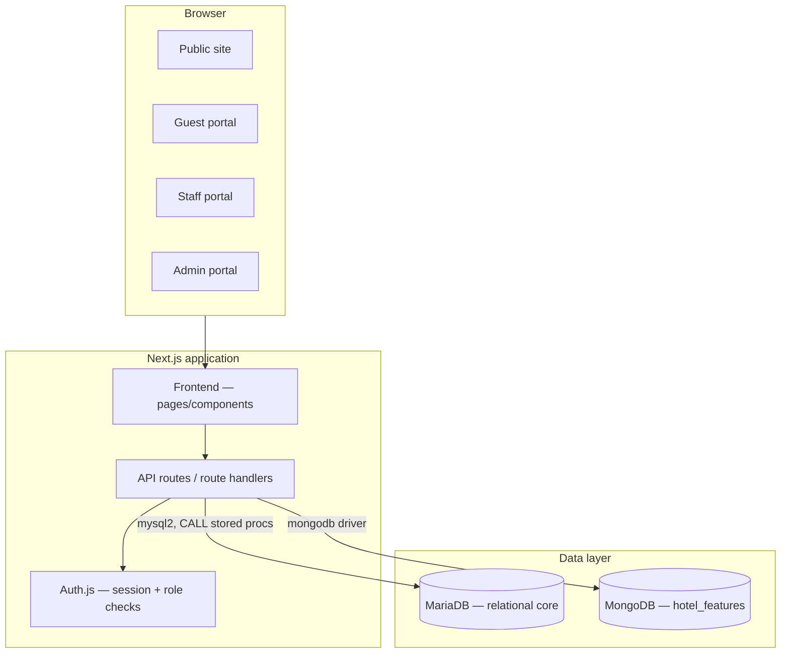

# Hotel Franchise CRS — Architecture & Design Document

Project: Hotel Franchise Central Reservation System (CRS) with Overbooking Logic
Course: DBMS
Status: reference document for implementation (human or AI agent). This document is the
source of truth for how the system is structured. `FUNCTIONAL_REQUIREMENTS.odt` says
*what* the system must do; this document says *how* it is built. `IMPLEMENTATION_PHASES.md`
says *in what order*.

---

## 1. Purpose and scope

The existing deliverable (`hotel_crs_ddl.sql`, `hotel_crs_dml.sql`) is a complete,
working relational core: a franchise → hotel → room_type → room containment hierarchy,
a two-layer overbooking engine (soft reservation-level buffer + hard physical-room
trigger), and a FIFO waitlist-promotion flow. That core is **not being redesigned**.

This document describes everything being *added* around that core to satisfy the
requirements:

- A second database paradigm (MongoDB, document store) for data that is genuinely
  schema-flexible (per-hotel amenities), not a duplicate of relational data.
- A Next.js web application (public site + three authenticated portals) with an API
  layer in front of both databases.
- Role-based authentication and authorization (Guest, Staff, Admin).
- Real calendar dates for availability, booking, and reporting.
- Simulated (non-real) payments.

## 2. Actors

| Actor | Description |
|---|---|
| Public visitor | No account. Browses the marketing site and hotel listings. |
| Guest | Registered customer. Searches, books, pays, cancels, views own bookings. |
| Staff | Employee scoped to exactly one hotel (`hotel_id` set). Manages that hotel's arrivals and physical room assignment. |
| Admin | Franchise-level employee (`hotel_id` is NULL). Manages hotels, room types, overbooking policy, amenities, reports, and the inventory chart. |

## 3. High-level architecture



**Components**

1. **Next.js frontend** — server-rendered pages for the public site and the three
   portals. No business logic lives here; it renders what the API returns and
   submits forms to API routes.
2. **API / backend layer** — Next.js Route Handlers. Every write and every read
   that touches either database goes through here. Owns: input validation,
   calling stored procedures, merging SQL + Mongo responses, enforcing
   auth/roles, translating DB errors (including the `SQLSTATE 45000` trigger
   signal) into clean API error responses.
3. **MariaDB (SQL core)** — unchanged schema plus the additions below. Holds all
   transactional and structural data: franchise/hotel/room hierarchy, bookings,
   payments, staff/guest accounts, and overbooking policy.
4. **MongoDB (`hotel_features` collection)** — one flexible document per hotel,
   holding amenities and per-room-type feature sets. Never holds anything that is
   also a row in MariaDB (no duplication, no sync problem).
5. **Auth.js** — credentials-based login, one JWT session shape shared by Guest,
   Staff, and Admin, differentiated by a `role` claim (and `hotelId` for Staff).

## 4. Data architecture

### 4.1 MariaDB — relational core

**Core tables (see `hotel_crs_ddl.sql` for full DDL):**

| Table | Purpose |
|---|---|
| `franchise` | The single franchise brand. |
| `hotel` | Properties under the franchise. |
| `room_type` | Sellable room categories per hotel (price, occupancy, physical count). |
| `room` | Physical rooms, one row per real room. |
| `guest` | Customer records. |
| `overbooking_policy` | Per-room-type **base** overbook percentage. |
| `room_type_inventory` | Per-night booked-count ledger — the row the engine locks. |
| `daily_inventory_plan` | Materialised per-hotel/per-night physical, base-buffer, adaptive-buffer, max-sellable, and booked counts for the admin chart. Rebuilt by the refresh procedures; it is a read model, not a second source of truth. |
| `booking` | A reservation for a room *type* (not a physical room) with status, including `Waitlisted`. |
| `room_assignment` | Physical room ↔ booking link, created at/near check-in. |
| `payment` | Payment records (simulated — see §8). |
| `cancellation_history` | Audit trail of cancellations. |

**View / function / procedures / trigger:**

| Object | Type | Purpose |
|---|---|---|
| `vw_roomtype_overview` | View | Per-room-type capacity + **base** buffer + base max sellable rooms. Static; not date-specific. |
| `fn_dynamic_buffer_rooms(room_type_id, stay_date)` | Function | The adaptive feedback rule. Starts from the base buffer and adds/subtracts a proportional adjustment based on the previous night’s whole-hotel occupancy, capped at ± base. Returns the base buffer when the previous night has no ledger rows. |
| `fn_available_rooms(room_type_id, stay_date)` | Function | Read-only rooms-left check for one night. Uses the same adaptive buffer as the booking procedures. |
| `sp_refresh_hotel_inventory_plan(hotel_id, start_date, days)` | Procedure | Rebuilds `daily_inventory_plan` for one hotel over a date range. |
| `sp_refresh_inventory_plan(start_date, days)` | Procedure | Loops over every hotel and calls the per-hotel refresh. |
| `sp_create_booking(...)` | Procedure | The core accept/overbook/waitlist decision. Locks the tightest night in the stay range with `SELECT ... FOR UPDATE`, then confirms, confirms-overbooked, or waitlists. Uses `fn_dynamic_buffer_rooms()` per night. |
| `sp_cancel_booking(booking_id, reason)` | Procedure | Cancels, frees ledger rows, logs to `cancellation_history`, then attempts FIFO waitlist promotion. |
| `sp_try_promote_waitlist(booking_id)` | Procedure | Re-runs the lock-and-check logic for the oldest waitlisted booking after a cancellation. |
| `trg_prevent_room_double_assignment` | Trigger (`BEFORE INSERT ON room_assignment`) | Hard-layer guarantee: refuses an overlapping-date double assignment of one physical room, raising `SIGNAL SQLSTATE '45000'`. |

**New tables required:**

```sql
-- Staff / Admin identity. hotel_id is NULL for franchise-wide Admin,
-- set for a hotel-scoped Staff account. This single nullable FK is the
-- entire Admin-vs-Staff scoping model.
CREATE TABLE staff_account (
    staff_id        INT AUTO_INCREMENT PRIMARY KEY,
    hotel_id        INT NULL,
    full_name       VARCHAR(100) NOT NULL,
    email           VARCHAR(100) NOT NULL,
    password_hash   VARCHAR(255) NOT NULL,
    role            ENUM('Admin','Staff') NOT NULL,
    created_on      DATETIME NOT NULL DEFAULT CURRENT_TIMESTAMP,
    CONSTRAINT fk_staff_hotel FOREIGN KEY (hotel_id)
        REFERENCES hotel(hotel_id) ON DELETE CASCADE ON UPDATE CASCADE,
    CONSTRAINT uq_staff_email UNIQUE (email)
) ENGINE=InnoDB;

-- Guest self-service login.
ALTER TABLE guest ADD COLUMN password_hash VARCHAR(255) NOT NULL DEFAULT '';

-- Adaptive inventory read model. Physical capacity is constant; the buffer and
-- max-sellable columns are recomputed per night from the previous night's
-- occupancy by sp_refresh_hotel_inventory_plan().
CREATE TABLE daily_inventory_plan (
    plan_id             BIGINT AUTO_INCREMENT PRIMARY KEY,
    hotel_id            INT NOT NULL,
    stay_date           DATE NOT NULL,
    physical_rooms      INT NOT NULL,
    base_buffer_rooms   INT NOT NULL DEFAULT 0,
    buffer_rooms        INT NOT NULL DEFAULT 0,
    max_sellable_rooms  INT NOT NULL,
    booked_rooms        INT NOT NULL DEFAULT 0,
    generated_on        DATETIME NOT NULL DEFAULT CURRENT_TIMESTAMP
                         ON UPDATE CURRENT_TIMESTAMP,
    CONSTRAINT fk_daily_plan_hotel FOREIGN KEY (hotel_id)
        REFERENCES hotel(hotel_id) ON DELETE CASCADE ON UPDATE CASCADE,
    CONSTRAINT uq_daily_plan_hotel_date UNIQUE (hotel_id, stay_date),
    CONSTRAINT chk_plan_nonneg CHECK (
        physical_rooms >= 0 AND base_buffer_rooms >= 0
        AND buffer_rooms >= 0 AND booked_rooms >= 0
    )
) ENGINE=InnoDB;
```

`daily_inventory_plan` is intentionally allowed to be stale between requests.
`GET /api/admin/reports/inventory` calls the refresh procedure for the requested
date range before reading it, so the chart always reflects the current ledger.
The booking engine does **not** read the plan table; it calls
`fn_dynamic_buffer_rooms()` directly while holding row locks. That keeps the read
model out of the transaction path.

`trg_staff_account_scope_insert` and `trg_staff_account_scope_update` enforce
the Admin/Staff `hotel_id` rule. This is deliberately a trigger rather than a
`CHECK`: MariaDB 11.8 rejects this `CHECK` over a foreign-key column when it
uses `ON UPDATE CASCADE`.

Implementation additions on top of the original core: `booking.special_requests
VARCHAR(500)` (the booking form's optional request), and
`sp_cancel_booking` marks any completed payment as `Refunded`, records the
amount in `cancellation_history.refund_amount`, and releases the booking's
physical `room_assignment`.

### 4.2 MongoDB — `hotel_features` collection

One document per hotel, logically keyed to `hotel.hotel_id`. This is where
per-hotel and per-room-type data that does **not** have a fixed field set lives —
the opposite of a relational table, by design.

```json
{
  "hotel_id": 1,
  "amenities": {
    "general": ["free wifi", "24hr front desk", "parking"],
    "wellness": ["pool", "gym"],
    "policies": { "pet_friendly": true, "check_in_time": "14:00" }
  },
  "room_type_features": {
    "Standard": { "ac": true, "tv": "32 inch" },
    "Deluxe":   { "ac": true, "tv": "43 inch smart", "balcony": true, "minibar": true },
    "Suite":    { "ac": true, "tv": "55 inch smart", "balcony": true, "jacuzzi": true }
  }
}
```

Index: `db.hotel_features.createIndex({ hotel_id: 1 }, { unique: true })`

Required aggregation-pipeline feature (satisfies the rubric's NoSQL-advanced-feature
requirement): group hotels by amenity or by city and count matches, e.g. "how many
hotels have a pool, grouped by city" using `$unwind` on `amenities.wellness` +
`$group`.

### 4.3 Cross-database consistency

`hotel_id` in a `hotel_features` document is **not** an enforced foreign key —
MariaDB and MongoDB cannot share a transaction or a constraint. The two are
stitched together only at the API layer: a "hotel detail" endpoint fetches the SQL
row and the Mongo document separately and merges them in the response. This is
standard polyglot-persistence practice and is called out explicitly here so it
reads as a deliberate design decision, not an oversight.

Consequence: deleting a hotel in MariaDB (`ON DELETE CASCADE` down the hierarchy)
does **not** automatically delete its `hotel_features` document. The hotel-delete
API route is responsible for issuing both deletes. An orphaned Mongo document with
no matching `hotel_id` is treated as inert, unreferenced data — not an error state.

## 5. Time model — real calendar dates

There is **no virtual clock**. The system uses the database/server's real
calendar date (`CURDATE()` / `CURRENT_DATE`) and real timestamps for audit
columns such as `booking.booking_date`, `payment.payment_date`, and
`cancellation_history.cancelled_on`.

- Availability defaults are “tomorrow + 2 nights”, derived from the real date.
- The sample DML uses dates relative to `CURRENT_DATE`, so “today’s arrivals”
  are populated whenever the seed is loaded.
- Reports and the admin inventory chart show the next N real calendar days.
- No background event scheduler is required. MariaDB's `EVENT` privilege is not
  part of the application grant.

This keeps the demo deterministic and avoids a clock that moves while a human is
trying to read or book a stay.

## 6. Authentication & authorization subsystem

**Session model.** Auth.js (NextAuth) with a Credentials provider. A JWT session
carries:

```json
{ "sub": "<id>", "actorType": "guest" | "staff", "role": "Guest" | "Staff" | "Admin", "hotelId": <int|null> }
```

`guest` rows authenticate against `guest.password_hash`; `staff_account` rows
authenticate against `staff_account.password_hash`, and `role`/`hotel_id` come
straight off that row (Admin → `hotel_id = NULL`, Staff → `hotel_id` set).

**Route protection — middleware, not UI hiding.** Every API route starts with a
role check before touching either database. UI navigation hiding is cosmetic only;
the enforcement point is the API route itself, so a Guest hitting an Admin endpoint
directly gets a `403`, not just a hidden nav link. Pattern:

```
requireRole(session, ['Admin'])                 // admin-only endpoint
requireRole(session, ['Staff'], { sameHotel: true })  // staff endpoint scoped to their own hotel_id
requireRole(session, ['Guest'])                  // guest endpoint
requireOwnership(session, booking.guest_id)      // a guest may only cancel their own booking
```

**Role capability matrix**

| Capability | Guest | Staff (own hotel) | Admin |
|---|---|---|---|
| Register / log in | ✓ (self) | — (provisioned by Admin) | — (provisioned at setup) |
| Search availability, view hotel detail + amenities | ✓ | ✓ | ✓ |
| Create booking | ✓ (self) | — | — |
| Cancel booking | ✓ (own) | — | — |
| View own bookings / payments | ✓ | — | — |
| View bookings/arrivals for their hotel | — | ✓ | ✓ (all hotels) |
| Assign physical room | — | ✓ | — |
| Create/edit hotel, room type | — | — | ✓ |
| Edit overbooking policy | — | — | ✓ |
| Edit amenities (Mongo) | — | — | ✓ |
| View reports (overbooking buffer usage, amenity aggregation, daily inventory chart) | — | — | ✓ |

## 7. Sample data and demo preparation

There is **no simulation engine** and no synthetic traffic process. The demo is
driven by seeded data plus the presenter's own actions:

- `hotel_crs_dml.sql` seeds six hotels / 18 room types / 100 physical rooms,
  20 guests, seven staff/admin accounts, overbooking policies, and bookings
  around the current real date.
- The seed includes a paid + assigned booking, a paid + unassigned booking, and
  a pending-payment booking so the staff desk has meaningful states.
- The Koramangala Standard bookings exercise the overbooking buffer and the
  waitlist promotion flow.
- Each additional property has its own staff account (`staff.whitefield@…`,
  `staff.hitech@…`, `staff.bkc@…`, `staff.aerocity@…`), scoped to that hotel.
- `sp_seed_demo_demand()` adds a patterned three-week demand wave (one-night
  stays at varying target occupancies). It is idempotent via the
  `special_requests = 'Demo demand wave seed'` marker and skips today/tomorrow
  for Koramangala/Andheri so the scripted overbooking walkthrough is preserved.
- `SQL/hotel_crs_adaptive_inventory.sql` applies the adaptive schema, the new
  properties, and the demand wave to an **existing** database without dropping
  user data.
- Presenters can create a guest account and make their own bookings through the
  UI, then inspect those bookings in the staff and admin consoles.

The full presentation run sheet lives in `DOCS/DEMO_GUIDE.md`.

## 8. Payment simulation

No real payment gateway. A booking's payment step inserts a `payment` row
directly (`payment_method` chosen by the user, `payment_status` set to
`'Completed'`). The **amount is always read from `booking.total_amount` on the
server** — a client cannot choose how much to pay. Exactly the shape already
present in `hotel_crs_dml.sql`. This is normal and expected for a course
project; documented here so it reads as an explicit decision rather than an
unfinished feature.

## 9. API route map

| Method | Path | Auth | Description |
|---|---|---|---|
| GET | `/api/hotels` | Public | List hotels (SQL) merged with amenities summary (Mongo). |
| GET | `/api/hotels/:id` | Public | Hotel detail: SQL row + room types + `hotel_features` doc. |
| GET | `/api/availability` | Public | Wraps `fn_available_rooms` for a city/date search. |
| POST | `/api/auth/register` | Public | Creates a `guest` row (hashes password). |
| POST | `/api/auth/login` | Public | Auth.js credentials sign-in. |
| POST | `/api/bookings` | Guest | Calls `sp_create_booking`; returns Confirmed / Confirmed-overbooked / Waitlisted. |
| GET | `/api/bookings/mine` | Guest | Own bookings + payment status. |
| POST | `/api/bookings/:id/cancel` | Guest (own) | Calls `sp_cancel_booking`. |
| POST | `/api/payments` | Guest (own booking) | Inserts a simulated `payment` row. |
| GET | `/api/staff/bookings` | Staff | Bookings/arrivals for `session.hotelId` only. |
| GET | `/api/staff/rooms?booking_id=` | Staff | Physical rooms of the booking's type, marked occupied/free for its dates. |
| POST | `/api/staff/assign-room` | Staff | Inserts `room_assignment`; translates a `45000` trigger signal into a clean "room already occupied" API error. |
| GET/POST/PUT | `/api/admin/hotels`, `/api/admin/room-types` | Admin | CRUD on the hierarchy. |
| POST | `/api/admin/room-types/:id/rooms` | Admin | Creates missing physical `room` rows for a room type. |
| PUT | `/api/admin/overbooking-policy/:roomTypeId` | Admin | Edits `overbook_percentage`. |
| PUT | `/api/admin/hotels/:id/features` | Admin | Edits the `hotel_features` Mongo document. |
| GET | `/api/admin/reports/overbooked` | Admin | The overbooked-bookings query from `hotel_crs_dml.sql`. |
| GET | `/api/admin/reports/amenities` | Admin | The Mongo aggregation (amenity counts by city). |
| GET | `/api/admin/reports/inventory` | Admin | Refreshes and returns the adaptive daily plan: physical rooms (flat), base buffer, adaptive buffer, max sellable, and booked counts for 7–60 real days. |

## 10. Frontend page/route map

| Route | Access | Purpose |
|---|---|---|
| `/` | Public | Marketing landing page with availability search. |
| `/hotels`, `/hotels/[id]` | Public | Listings and detail (amenities from Mongo). |
| `/register`, `/login` | Public | Guest self-registration; shared login form for all three roles. |
| `/book/[roomTypeId]` | Guest | Booking form; shows the three possible outcomes explicitly. |
| `/my-bookings` | Guest | Own bookings, payment, cancellation, refunds, waitlist status. |
| `/staff` | Staff / Admin | Hotel-scoped arrivals, room assignment; Admin gets a hotel selector. |
| `/admin` | Admin | Catalog, overbooking, structured amenities, inventory chart, reports. |

## 11. Error handling conventions

- Every API route returns `{ error: { code, message } }` on failure, with the HTTP
  status matching the failure class (`400` validation, `401` unauthenticated, `403`
  unauthorized, `409` conflict, `500` unexpected).
- The room-assignment route specifically catches the driver-level error carrying
  `SQLSTATE '45000'` from `trg_prevent_room_double_assignment` and maps it to a
  `409` with a human-readable message — never surface a raw SQL error to the UI.
- Room assignment requires a `Completed` payment; otherwise the API returns
  `409 PAYMENT_REQUIRED`. This is a deliberate staff-desk gate.
- Cancelling a paid booking marks the payment `Refunded`, records the refund in
  `cancellation_history`, and releases the physical room assignment.
- `sp_create_booking`'s `p_status` OUT parameter (`CONFIRMED` /
  `CONFIRMED_OVERBOOKED` / `WAITLISTED` / `INVALID_DATES` /
  `INVALID_ROOM_TYPE` / `INVALID_GUESTS` / `ERROR`) is passed straight through to
  the frontend so the UI can show the distinction honestly — this is the single
  most important piece of information the booking flow produces.

## 12. Environment variables

```
DB_HOST=
DB_PORT=3306
DB_USER=
DB_PASSWORD=
DB_NAME=hotel_crs
MONGODB_URI=
AUTH_SECRET=
NEXTAUTH_URL=
```

All of the above are read from `.env.local` (gitignored); nothing above is ever
hardcoded in source.

## 13. Non-functional notes

This is a course project, not a production system: no horizontal scaling, no
connection pooling tuning, no production-grade secrets management beyond env vars.
Priorities in order: (1) correctness of the overbooking/waitlist logic end to end
through the UI, (2) a clear, repeatable demo from seeded data, (3) clean role
separation, (4) everything else.
