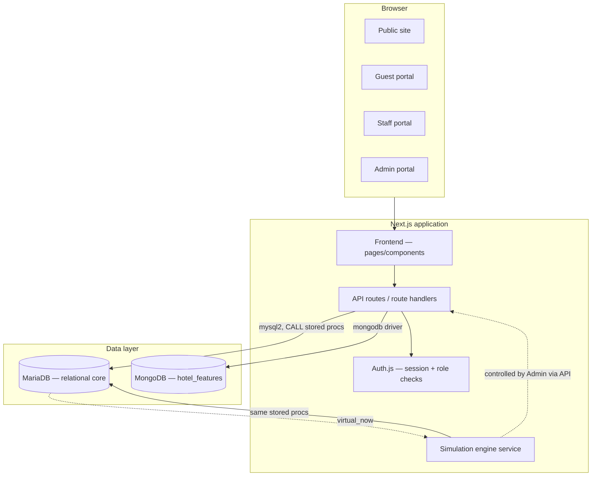

# Hotel Franchise CRS — Architecture & Design Document

Project: Hotel Franchise Central Reservation System (CRS) with Overbooking Logic
Course: DBMS
Status: reference document for implementation (human or AI agent). This document is the
source of truth for how the system is structured. `FUNCTIONAL_REQUIREMENTS.odt` says
*what* the system must do; this document says *how* it is built. `IMPLEMENTATION_PHASES.md`
says *in what order*.

---

## 1. Purpose and scope

The existing deliverable (`hotel_crs_ddl.sql`, `hotel_crs_dml.sql`) is a complete,
working relational core: a franchise → hotel → room_type → room containment hierarchy,
a two-layer overbooking engine (soft reservation-level buffer + hard physical-room
trigger), and a FIFO waitlist-promotion flow. That core is **not being redesigned**.

This document describes everything being *added* around that core to satisfy the
requirements:

- A second database paradigm (MongoDB, document store) for data that is genuinely
  schema-flexible (per-hotel amenities), not a duplicate of relational data.
- A Next.js web application (public site + three authenticated portals) with an API
  layer in front of both databases.
- Role-based authentication and authorization (Guest, Staff, Admin).
- A virtual clock subsystem that can run, pause, resume, and fast-forward
  independently of wall-clock time, persisted so it survives restarts.
- A simulation engine that drives synthetic guest traffic through the system for
  demo purposes.
- Simulated (non-real) payments.

## 2. Actors

| Actor | Description |
|---|---|
| Public visitor | No account. Browses the marketing site and hotel listings. |
| Guest | Registered customer. Searches, books, cancels, views own bookings. |
| Staff | Employee scoped to exactly one hotel (`hotel_id` set). Manages that hotel's arrivals and physical room assignment. |
| Admin | Franchise-level employee (`hotel_id` is NULL). Manages hotels, room types, overbooking policy, amenities, reports, the virtual clock, and the simulation engine. |
| Simulation engine | Not a human actor — a backend process, started/stopped/configured by Admin, that acts as many synthetic Guests to generate demo traffic. |

## 3. High-level architecture



**Components**

1. **Next.js frontend** — server-rendered pages for the public site and the three
   portals. No business logic lives here; it renders what the API returns and
   submits forms to API routes.
2. **API / backend layer** — Next.js API routes (or Route Handlers). Every write and
   every read that touches either database goes through here. Owns: input
   validation, calling stored procedures, merging SQL + Mongo responses, enforcing
   auth/roles, translating DB errors (including the `SQLSTATE 45000` trigger signal)
   into clean API error responses.
3. **MariaDB (SQL core)** — unchanged schema plus the additions in §5–§7 below.
   Holds all transactional and structural data: franchise/hotel/room hierarchy,
   bookings, payments, staff/guest accounts, overbooking policy, the virtual clock.
4. **MongoDB (`hotel_features` collection)** — one flexible document per hotel,
   holding amenities and per-room-type feature sets. Never holds anything that is
   also a row in MariaDB (no duplication, no sync problem).
5. **Auth.js** — credentials-based login, one JWT session shape shared by Guest,
   Staff, and Admin, differentiated by a `role` claim (and `hotelId` for Staff).
6. **Simulation engine** — an in-process service (not a serverless function —
   see §7) that, when started by Admin, periodically calls the same
   `sp_create_booking` / `sp_cancel_booking` procedures the real API uses, acting as
   synthetic guests.

## 4. Data architecture

### 4.1 MariaDB — relational core

**Existing tables (unchanged — see `hotel_crs_ddl.sql` for full DDL):**

| Table | Purpose |
|---|---|
| `franchise` | The single franchise brand. |
| `hotel` | Properties under the franchise. |
| `room_type` | Sellable room categories per hotel (price, occupancy, physical count). |
| `room` | Physical rooms, one row per real room. |
| `guest` | Customer records. |
| `overbooking_policy` | Per-room-type overbook percentage. |
| `room_type_inventory` | Per-night booked-count ledger — the row the engine locks. |
| `booking` | A reservation for a room *type* (not a physical room) with status, including `Waitlisted`. |
| `room_assignment` | Physical room ↔ booking link, created at/near check-in. |
| `payment` | Payment records (simulated — see §8). |
| `cancellation_history` | Audit trail of cancellations. |

**Existing view / function / procedures / trigger:**

| Object | Type | Purpose |
|---|---|---|
| `vw_roomtype_overview` | View | Per-room-type capacity + buffer + max sellable rooms. |
| `fn_available_rooms(room_type_id, stay_date)` | Function | Read-only rooms-left check for one night. |
| `sp_create_booking(...)` | Procedure | The core accept/overbook/waitlist decision. Locks the tightest night in the stay range with `SELECT ... FOR UPDATE`, then confirms, confirms-overbooked, or waitlists. |
| `sp_cancel_booking(booking_id, reason)` | Procedure | Cancels, frees ledger rows, logs to `cancellation_history`, then attempts FIFO waitlist promotion. |
| `sp_try_promote_waitlist(booking_id)` | Procedure | Re-runs the lock-and-check logic for the oldest waitlisted booking after a cancellation. |
| `trg_prevent_room_double_assignment` | Trigger (`BEFORE INSERT ON room_assignment`) | Hard-layer guarantee: refuses an overlapping-date double assignment of one physical room, raising `SIGNAL SQLSTATE '45000'`. |

**New tables required:**

```sql
-- Staff / Admin identity. hotel_id is NULL for franchise-wide Admin,
-- set for a hotel-scoped Staff account. This single nullable FK is the
-- entire Admin-vs-Staff scoping model.
CREATE TABLE staff_account (
    staff_id        INT AUTO_INCREMENT PRIMARY KEY,
    hotel_id        INT NULL,
    full_name       VARCHAR(100) NOT NULL,
    email           VARCHAR(100) NOT NULL,
    password_hash   VARCHAR(255) NOT NULL,
    role            ENUM('Admin','Staff') NOT NULL,
    created_on      DATETIME NOT NULL DEFAULT CURRENT_TIMESTAMP,
    CONSTRAINT fk_staff_hotel FOREIGN KEY (hotel_id)
        REFERENCES hotel(hotel_id) ON DELETE CASCADE ON UPDATE CASCADE,
    CONSTRAINT uq_staff_email UNIQUE (email)
) ENGINE=InnoDB;

-- Guest self-service login + simulation tagging.
ALTER TABLE guest ADD COLUMN password_hash VARCHAR(255) NOT NULL DEFAULT '';
ALTER TABLE guest ADD COLUMN is_synthetic  BOOLEAN NOT NULL DEFAULT FALSE;

-- The virtual clock. Single-row table (clock_id is always 1).
CREATE TABLE sim_clock (
    clock_id      TINYINT PRIMARY KEY DEFAULT 1,
    virtual_now   DATETIME NOT NULL,
    tick_minutes  INT NOT NULL DEFAULT 60,   -- virtual minutes advanced per real tick
    is_running    BOOLEAN NOT NULL DEFAULT TRUE,
    CONSTRAINT chk_single_clock_row CHECK (clock_id = 1)
) ENGINE=InnoDB;

INSERT INTO sim_clock (clock_id, virtual_now) VALUES (1, NOW());
```

`trg_staff_account_scope_insert` and `trg_staff_account_scope_update` enforce
the Admin/Staff `hotel_id` rule. This is deliberately a trigger rather than a
`CHECK`: MariaDB 11.8 rejects this `CHECK` over a foreign-key column when it
uses `ON UPDATE CASCADE`.

**Virtual-clock event (see §5 for full discussion):**

```sql
DELIMITER $$
CREATE EVENT evt_clock_tick
ON SCHEDULE EVERY 1 SECOND
DO
BEGIN
    UPDATE sim_clock
    SET virtual_now = virtual_now + INTERVAL tick_minutes MINUTE
    WHERE clock_id = 1 AND is_running = TRUE;
END$$
DELIMITER ;

SET GLOBAL event_scheduler = ON;  -- must also be set in my.cnf to persist across server restarts
```

### 4.2 MongoDB — `hotel_features` collection

One document per hotel, logically keyed to `hotel.hotel_id`. This is where
per-hotel and per-room-type data that does **not** have a fixed field set lives —
the opposite of a relational table, by design.

```json
{
  "hotel_id": 1,
  "amenities": {
    "general": ["free wifi", "24hr front desk", "parking"],
    "wellness": ["pool", "gym"],
    "policies": { "pet_friendly": true, "check_in_time": "14:00" }
  },
  "room_type_features": {
    "Standard": { "ac": true, "tv": "32 inch" },
    "Deluxe":   { "ac": true, "tv": "43 inch smart", "balcony": true, "minibar": true },
    "Suite":    { "ac": true, "tv": "55 inch smart", "balcony": true, "jacuzzi": true }
  }
}
```

Index: `db.hotel_features.createIndex({ hotel_id: 1 }, { unique: true })`

Required aggregation-pipeline feature (satisfies the rubric's NoSQL-advanced-feature
requirement): group hotels by amenity or by city and count matches, e.g. "how many
hotels have a pool, grouped by city" using `$unwind` on `amenities.wellness` +
`$group`.

### 4.3 Cross-database consistency

`hotel_id` in a `hotel_features` document is **not** an enforced foreign key —
MariaDB and MongoDB cannot share a transaction or a constraint. The two are
stitched together only at the API layer: a "hotel detail" endpoint fetches the SQL
row and the Mongo document separately and merges them in the response. This is
standard polyglot-persistence practice and is called out explicitly here so it
reads as a deliberate design decision, not an oversight.

Consequence: deleting a hotel in MariaDB (`ON DELETE CASCADE` down the hierarchy)
does **not** automatically delete its `hotel_features` document. The hotel-delete
API route is responsible for issuing both deletes. An orphaned Mongo document with
no matching `hotel_id` is treated as inert, unreferenced data — not an error state.

## 5. Virtual clock subsystem

**Design decision: the clock lives in the database (MariaDB event scheduler),
not a snapshot file.** MariaDB already persists every write to disk and already
survives restarts by design — a hand-rolled JSON snapshot file would be a second,
separate persistence mechanism that has to be kept in sync with everything else for
no benefit. The database is also the one component everything else (bookings,
simulation, reports) already depends on.

- **Run** — `evt_clock_tick` fires every real second and advances
  `sim_clock.virtual_now` by `tick_minutes` virtual minutes.
- **Pause** — `ALTER EVENT evt_clock_tick DISABLE;` (and set `is_running = FALSE`
  for the admin UI to read back). Time stops exactly where it was; nothing needs to
  be "saved" because nothing has moved except a row that's already on disk.
- **Resume** — `ALTER EVENT evt_clock_tick ENABLE;` / `is_running = TRUE`. Picks up
  from the current `virtual_now`.
- **Restart survival** — `sim_clock` is a table; its last value is whatever was last
  committed. The event resumes firing on server start as long as
  `event_scheduler = ON` is set (both at runtime and in `my.cnf`, so it survives a
  full MariaDB restart, not just an application restart).
- **Fast-forward** — `UPDATE sim_clock SET virtual_now = virtual_now + INTERVAL n DAY WHERE clock_id = 1;`
- **Rate control** — Admin updates `tick_minutes` to speed up or slow down how fast
  virtual time moves relative to real time.

**Virtual time vs. audit timestamps — a deliberate split.** `booking.booking_date`,
`payment.payment_date`, `room_assignment.assigned_on`, `cancellation_history.cancelled_on`,
and `guest.registered_on` keep their existing `DEFAULT CURRENT_TIMESTAMP` /
`DEFAULT CURRENT_DATE` behavior — they are an audit trail of when something was
recorded in real wall-clock time, and rewriting every stored procedure to stamp them
with `virtual_now` instead would be invasive for no benefit. **Virtual time is used
only for business-logic decisions that are meant to simulate the passage of time**:
what "today" is for availability search defaults, when a confirmed booking's
check-in date has "arrived" (for a future auto-no-show job, if built), and what
pace the simulation engine spawns/cancels bookings at. The API layer is the only
thing that ever reads `sim_clock.virtual_now`; stored procedures continue to accept
explicit `DATE` parameters exactly as they do today, so **no existing procedure
needs to be rewritten** — the API layer simply passes dates derived from
`virtual_now` instead of from the real OS clock when the context calls for it.

## 6. Authentication & authorization subsystem

**Session model.** Auth.js (NextAuth) with a Credentials provider. A JWT session
carries:

```json
{ "sub": "<id>", "actorType": "guest" | "staff", "role": "Guest" | "Staff" | "Admin", "hotelId": <int|null> }
```

`guest` rows authenticate against `guest.password_hash`; `staff_account` rows
authenticate against `staff_account.password_hash`, and `role`/`hotel_id` come
straight off that row (Admin → `hotel_id = NULL`, Staff → `hotel_id` set).

**Route protection — middleware, not UI hiding.** Every API route starts with a
role check before touching either database. UI navigation hiding is cosmetic only;
the enforcement point is the API route itself, so a Guest hitting an Admin endpoint
directly gets a `403`, not just a hidden nav link. Pattern:

```
requireRole(session, ['Admin'])                 // admin-only endpoint
requireRole(session, ['Staff'], { sameHotel: true })  // staff endpoint scoped to their own hotel_id
requireRole(session, ['Guest'])                  // guest endpoint
requireOwnership(session, booking.guest_id)      // a guest may only cancel their own booking
```

**Role capability matrix**

| Capability | Guest | Staff (own hotel) | Admin |
|---|---|---|---|
| Register / log in | ✓ (self) | — (provisioned by Admin) | — (provisioned at setup) |
| Search availability, view hotel detail + amenities | ✓ | ✓ | ✓ |
| Create booking | ✓ (self) | — | — |
| Cancel booking | ✓ (own) | — | — |
| View own bookings / payments | ✓ | — | — |
| View bookings/arrivals for their hotel | — | ✓ | ✓ (all hotels) |
| Assign physical room | — | ✓ | — |
| Create/edit hotel, room type | — | — | ✓ |
| Edit overbooking policy | — | — | ✓ |
| Edit amenities (Mongo) | — | — | ✓ |
| View reports (occupancy, overbooking buffer usage, amenity aggregation) | — | — | ✓ |
| Control virtual clock | — | — | ✓ |
| Control simulation engine | — | — | ✓ |

## 7. Simulation engine subsystem

**Why this is an in-process service, not a stored procedure or a serverless
function.** "Spawn a client with a profile, at a configurable rate, that sometimes
cancels, for a set duration" is stateful, probabilistic, long-running control logic
— comfortable in JS, awkward as nested SQL `CASE`/`RAND()` logic, and
incompatible with a stateless serverless function (nothing would keep the loop
running between invocations). It is implemented as a singleton service inside the
same persistent Node server process that hosts the Next.js app (a custom server, or
a small sidecar process reachable only by the API layer) — **not** as a Vercel-style
edge/serverless function.

**Mechanics.** On each cycle, the service:

1. Reads `sim_clock.virtual_now` (never the real OS clock — simulated demand should
   scale with virtual time, including fast-forwarded time).
2. Rolls against the configured spawn rate; if triggered, picks a **client
   archetype** and calls `sp_create_booking` with guest/room-type/date values drawn
   from that archetype, using (or lazily creating) a `guest` row flagged
   `is_synthetic = TRUE`.
3. Separately rolls each archetype's `cancelProb` against its own still-active
   synthetic bookings and calls `sp_cancel_booking` when triggered — this is what
   demonstrates FIFO waitlist promotion live during a demo.

**Client archetype shape** (admin-configurable, not hardcoded):

```json
{
  "name": "budget solo",
  "roomTypePreference": "Standard",
  "stayNights": [1, 2],
  "numGuests": 1,
  "cancelProbability": 0.10
}
```

**Admin control surface** (see API map in §9 for exact routes): start, stop,
set overall spawn rate, fast-forward the clock, spawn one booking of a specific
archetype on demand, and clear all synthetic data (deletes/resets rows where
`is_synthetic = TRUE`, for a clean slate before a live demo).

## 8. Payment simulation

No real payment gateway. A booking's payment step is a form that inserts a
`payment` row directly (`payment_method` chosen by the user, `payment_status`
set to `'Completed'` or left `'Pending'`) — exactly the shape already present in
`hotel_crs_dml.sql`. This is normal and expected for a course project; documented
here so it reads as an explicit decision rather than an unfinished feature.

## 9. API route map

| Method | Path | Auth | Description |
|---|---|---|---|
| GET | `/api/hotels` | Public | List hotels (SQL) merged with amenities summary (Mongo). |
| GET | `/api/hotels/:id` | Public | Hotel detail: SQL row + room types + `hotel_features` doc. |
| GET | `/api/availability` | Public | Wraps `fn_available_rooms` for a city/date search. |
| POST | `/api/auth/register` | Public | Creates a `guest` row (hashes password). |
| POST | `/api/auth/login` | Public | Auth.js credentials sign-in. |
| POST | `/api/bookings` | Guest | Calls `sp_create_booking`; returns Confirmed / Confirmed-overbooked / Waitlisted. |
| GET | `/api/bookings/mine` | Guest | Own bookings + payment status. |
| POST | `/api/bookings/:id/cancel` | Guest (own) | Calls `sp_cancel_booking`. |
| POST | `/api/payments` | Guest (own booking) | Inserts a simulated `payment` row. |
| GET | `/api/staff/bookings` | Staff | Bookings/arrivals for `session.hotelId` only. |
| POST | `/api/staff/assign-room` | Staff | Inserts `room_assignment`; translates a `45000` trigger signal into a clean "room already occupied" API error. |
| GET/POST/PUT | `/api/admin/hotels`, `/api/admin/room-types` | Admin | CRUD on the hierarchy. |
| PUT | `/api/admin/overbooking-policy/:roomTypeId` | Admin | Edits `overbook_percentage`. |
| PUT | `/api/admin/hotels/:id/features` | Admin | Edits the `hotel_features` Mongo document. |
| GET | `/api/admin/reports/overbooked` | Admin | The overbooked-bookings query from `hotel_crs_dml.sql`. |
| GET | `/api/admin/reports/amenities` | Admin | The Mongo aggregation (amenity counts by city). |
| GET/PUT | `/api/admin/clock` | Admin | Read/pause/resume/fast-forward/rate-change `sim_clock`. |
| GET/POST/PUT | `/api/admin/simulation` | Admin | Start/stop/configure archetypes/spawn-one/clear synthetic data. |

## 10. Frontend page/route map

| Route | Access | Purpose |
|---|---|---|
| `/` | Public | Marketing landing page. |
| `/hotels`, `/hotels/[id]` | Public | Listings and detail (amenities from Mongo). |
| `/register`, `/login` | Public | Guest self-registration; shared login form for all three roles. |
| `/book/[roomTypeId]` | Guest | Booking form; shows the three possible outcomes explicitly. |
| `/my-bookings` | Guest | Own bookings, cancel action, payment status. |
| `/staff` | Staff | Dashboard scoped to `session.hotelId`: arrivals, room assignment. |
| `/admin` | Admin | Hotel/room-type/overbooking-policy/amenities management, reports. |
| `/admin/clock` | Admin | Virtual clock controls. |
| `/admin/simulation` | Admin | Simulation engine controls. |

## 11. Error handling conventions

- Every API route returns `{ error: { code, message } }` on failure, with the HTTP
  status matching the failure class (`400` validation, `401` unauthenticated, `403`
  unauthorized, `409` conflict, `500` unexpected).
- The room-assignment route specifically catches the driver-level error carrying
  `SQLSTATE '45000'` from `trg_prevent_room_double_assignment` and maps it to a
  `409` with a human-readable message — never surface a raw SQL error to the UI.
- `sp_create_booking`'s `p_status` OUT parameter (`CONFIRMED` /
  `CONFIRMED_OVERBOOKED` / `WAITLISTED` / `INVALID_DATES` / `ERROR`) is passed
  straight through to the frontend so the UI can show the distinction honestly —
  this is the single most important piece of information the booking flow
  produces.

## 12. Environment variables

```
DB_HOST=
DB_PORT=3306
DB_USER=
DB_PASSWORD=
DB_NAME=hotel_crs
MONGODB_URI=
AUTH_SECRET=
NEXTAUTH_URL=
```

All of the above are read from `.env.local` (gitignored); nothing above is ever
hardcoded in source.

## 13. Non-functional notes

This is a course project, not a production system: no horizontal scaling, no
connection pooling tuning, no production-grade secrets management beyond env vars.
Priorities in order: (1) correctness of the overbooking/waitlist logic end to end
through the UI, (2) a demo-able simulation engine, (3) clean role separation,
(4) everything else.
